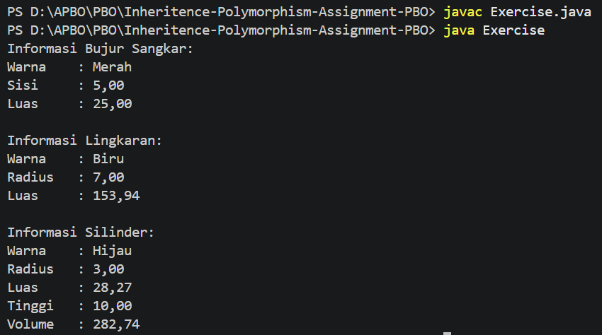

 # Contoh Encapsulation, Inheritance, dan Polymorphism

Kode ini merupakan contoh penerapan konsep dasar pemrograman berorientasi objek (OOP) menggunakan Java. Program memodelkan beberapa bentuk geometri, yaitu bujur sangkar, lingkaran, dan silinder.

## Struktur File

- `Bentuk.java`: superclass yang menyimpan atribut warna dan fungsi informasi umum.
- `BujurSangkar.java`: subclass dari `Bentuk` untuk menghitung luas bujur sangkar.
- `Lingkaran.java`: subclass dari `Bentuk` untuk menghitung luas lingkaran.
- `Silinder.java`: subclass dari `Lingkaran` untuk menghitung volume silinder.
- `Exercise.java`: class utama untuk membuat objek dan menjalankan program.

## Encapsulation

Encapsulation adalah konsep untuk membatasi akses langsung terhadap data objek dan menyediakan method untuk mengakses atau mengubahnya.

Contohnya terdapat pada atribut berikut:

```java
private double sisi;
private double radius;
private double tinggi;
```

Atribut tersebut tidak dapat diakses langsung dari luar class. Akses dilakukan melalui getter dan setter, seperti `getSisi()`, `setSisi()`, `getRadius()`, `setRadius()`, `getTinggi()`, dan `setTinggi()`.

Class `Bentuk` juga menyediakan `getWarna()` dan `setWarna()` untuk mengakses atribut `warna` melalui method.

## Inheritance

Inheritance adalah konsep pewarisan sifat dan perilaku dari superclass ke subclass.

Pada project ini, hubungan pewarisannya adalah:

```text
Bentuk
|-- BujurSangkar
|-- Lingkaran
	|-- Silinder
```

- `BujurSangkar extends Bentuk`, sehingga mewarisi atribut dan method dari `Bentuk`.
- `Lingkaran extends Bentuk`, sehingga juga memiliki perilaku umum dari `Bentuk`.
- `Silinder extends Lingkaran`, sehingga dapat menggunakan perhitungan luas lingkaran melalui `super.hitungLuas()` untuk menghitung volumenya.

## Polymorphism

Polymorphism memungkinkan method yang sama memiliki perilaku berbeda bergantung pada objek yang menjalankannya.

Method `printInfo()` didefinisikan pada `Bentuk`, kemudian ditimpa (override) oleh `BujurSangkar`, `Lingkaran`, dan `Silinder`. Setiap class menampilkan informasi yang berbeda:

- `BujurSangkar` menampilkan sisi dan luas.
- `Lingkaran` menampilkan radius dan luas.
- `Silinder` menampilkan radius, luas lingkaran, tinggi, dan volume.

Pada `Exercise.java`, pemanggilan `printInfo()` menghasilkan output sesuai jenis objek yang digunakan. Ini menunjukkan polymorphism melalui method overriding.

## Menjalankan Program

Pastikan Java Development Kit (JDK) telah terpasang, kemudian jalankan perintah berikut dari folder project:

```bash
javac Exercise.java
java Exercise
```

Program akan membuat objek `BujurSangkar`, `Lingkaran`, dan `Silinder`, lalu menampilkan informasi setiap objek.

Output Program:
